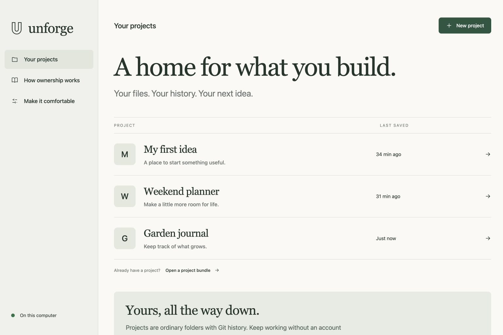

# Unforge

**Built for humans. Owned by you.**

A local home for software you own. Keep its files, history, and backups together — without a GitHub account, a hosted database, or an Unforge subscription. Ask an AI to help if you want. You keep the files.

Unforge is an open-source **working alpha**. Start a project, save versions, run checks on your Mac, and put encrypted backups on a drive you already own. Write a request for any coding agent. Optional local Codex and Subscription Fleet adapters use your own installed tools; review the change before you apply it.

## Start locally

Get Unforge from [unforge.app](https://unforge.app). You do not need a GitHub account.

**Mac app:** Open `Unforge.app` to use your workspace without Terminal, Python, or Node. It needs macOS 13+ and Git 2.30+. The download from unforge.app is Developer ID signed and notarized. Building from source on another Mac needs a Developer ID certificate for the same treatment. See [Mac app build and installation](docs/MAC_APP.md).

**Browser/CLI version:** on macOS or Linux, a built source release needs **Python 3.10+** and **Git 2.30+**. Building from source additionally needs **Node.js 22.12+ with npm**. Download the source archive from [unforge.app](https://unforge.app/guide.html#source), then open its folder in a terminal:

```sh
./start.sh
```

Open **http://127.0.0.1:4319**. On macOS, you can also double-click `start.command`, which starts the app and opens your browser. Keep its terminal open while using Unforge; press **Control-C** there to stop it.

If the built interface is absent, the first start installs pinned frontend dependencies with `npm ci --ignore-scripts` and builds it. That source setup requires Internet access. A built release includes the interface and skips this download. The core app runs locally without telemetry or a required cloud account. Optional agent jobs contact the configured provider and use your existing account allowance or charges. There is no hard dollar cap; the execution timeout is not a spending guarantee.

## What you can do today

- Create managed local Git projects, import a supported Git bundle, or review and copy a local app folder without modifying its original.
- Recover editor drafts and completed agent proposals after reopening Unforge.
- Run trusted static, Node, Python and Swift apps from separate saved source copies; use disposable previews or persistent managed app data.
- Execute configured checks locally, with bounded output and process cleanup.
- Work in ordinary Git lanes, including a lane from a preserved production ref. Checks use the exact saved commit and its own configuration. Resolve overlapping changes before merging that same checked commit.
- Configure meaningful local checks; an unconfigured project receives no passing receipt. Publish retained artifacts to a folder, Cloudflare Pages, or Supabase functions. Rollback restores the prior retained artifact. Explicitly observe existing Fly and Cloudflare Workers deployments through your own CLI accounts; observation does not deploy them. Working source, production refs, observed deployments, readiness, and recovery freshness are separate facts.
- Encrypted backups to iCloud Drive, Google Drive, or another disk. Unforge decrypts and verifies the exact captured snapshot before reporting success.
- Automatically back up reported changes while Unforge is open; the Mac build also watches changes from external editors.
- Adjust text size and technical-detail preferences.
- Read and edit small text files (up to 128 KiB each; the interface loads files and history in pages).
- Preview a static HTML page with scripts disabled.
- Save named versions as ordinary Git commits.
- Restore a saved version as a new commit when the working directory is clean.
- Export committed history as a standard Git bundle.
- Inspect recognized dependency and hosting configuration clues, with file/line evidence.
- Keep a portable project brief, behavior examples, setup notes, decisions, and credential locations without secret values.
- Record services, estimated monthly ranges with their sources, shared dependencies, and evidence about what remains active.
- Compare configuration consequences of an agent proposal and prepare a behavior-preserving simplification request.
- Record what happened when you tried a behavior in your own app, without confusing that observation with an automated test.
- Cap how often Unforge starts an AI or practice job each day. That is not a dollar limit. Replay the same job ID and it will not start twice.
- Practice buttons for fake email, payment, and webhook receipts. They don’t contact a real provider.
- Capture saved source and explicitly declared local data, rehearse its reconstruction, and restore a separate project copy.
- Complete a retirement plan after accounting for detected service references, shared resources, and a verified recovery capsule.
- Record a plain-language request under `.unforge/requests/` for handoff to your preferred coding agent.
- Describe an outcome, review a base-bound plan of the likely files and focused check, then ask an installed, signed-in Subscription Fleet for an isolated proposal. Exact-file controls remain available under Advanced; Codex remains an optional direct lane.

Saving a file and saving a version are separate steps. Save a version before exporting changes you want to preserve. Bundle upload accepts up to 20 MiB; local-path import through the CLI accepts up to 512 MiB. Imports require a supported current tree without symbolic links, submodules, or reserved files, with at most 128 MiB of file contents and 10,000 files.

The dependency and cost views look at files in the project. They cannot see real invoices or what is actually deployed. Amounts you type are your estimates. Capping how often Unforge starts a job is not a spending limit.

Unforge runs in a native Mac window or a local browser. It does not yet replace provider billing dashboards, team editing, every kind of repository, or a sandbox for untrusted apps. Practice buttons are fake receipts; they don’t switch your real app into a test account. See the [roadmap](docs/ROADMAP.md).

## Start with one useful project

1. Create a project or import a supported Git bundle. In **Project care → Your brief**, describe what it is for and one behavior that must keep working, such as “Save a note, reopen the app, and find it again.” Write the notes, then **Save a version**.
2. In **Services & costs**, record the accounts and resources the project depends on. Leave unknown amounts blank. Include who else uses a shared resource and where your estimate came from. Save another version after writing the records.
3. Open **Consequences** to inspect source clues. **Make this simpler** prepares an editable request that preserves your stated behaviors. Starting AI work is a separate action using your selected local account.
4. In **Usage & practice**, set your local daily attempt allowance. Try a pretend action, then replay the same action and see the existing receipt returned. No email is sent and no money moves.
5. In **Recovery**, create a capsule of the saved project. Add local SQLite data or uploads when appropriate; declare these paths in `.gitignore` and save that rule first. Choose **Rehearse recovery**, then download a copy to independent storage.
6. When retiring a project, update service records with what you checked and what you will retain. Save those records, create and rehearse a fresh capsule, then record the completed retirement plan. This records your evidence; it does not delete provider resources or establish that billing stopped.

Capsules are unencrypted and can contain private source history and declared data. Reconstruction checks archive contents and SQLite integrity; it does not execute the application or prove that logins and external integrations work. Keep credential values separately and use the brief to record where access is kept.

## Back up the whole workspace

Open **Backups & recovery** and choose a folder outside the active workspace. Keep active Git repositories on local storage; only completed encrypted recovery points go into a sync folder. The Mac app bundles the pinned Restic tool. Source users run `python3 scripts/fetch_restic.py` once.

Keep the recovery passphrase somewhere accessible without this Mac. **Losing both the Mac and its only copy of the passphrase makes the encrypted backups unrecoverable.** Save it in a password manager or independent safe place. A key stored in the same cloud account as the backup protects against laptop loss but does not protect the backup against compromise of that account.

New recovery points share an encrypted vault: unchanged files are stored once. Unforge streams an authenticated encrypted snapshot back and checks every captured file hash before reporting success. APFS capture clones and delta storage budgets reduce scratch space while preserving the reserve. Streaming verification does not mean a restored workspace or application was opened. Keep the **entire `.ufvault` folder**, including the `.ufpoint` you pick to recover. That small file by itself cannot restore your work. Older standalone `.ufbackup` copies still work. If a backup is interrupted, the points that already finished stay intact.

Routine destination publication reads back new encrypted objects and checks unchanged objects against private recorded file identities. It does not download every unchanged cloud pack again. Upgraded legacy points start with an explicitly labeled metadata baseline; this is weaker than a new content check. A separate restore or explicit recovery inspection reads and verifies all required objects. Publication, upload metadata, and cloud recovery evidence remain separate.

Automatic backup groups changes at your selected interval while Unforge is open. Failed captures retry independently after 5, 10, 20, 40, then 60 minutes; Retry now resumes pending work. Startup reconciliation protects changes made while the app was closed. Deduplication reduces repeated content; it does not make storage unlimited. Vaults roll over after 500 snapshots or 4,000 repository entries to keep recovery inventories manageable. A new vault needs a fresh encrypted seed; earlier vaults and private generations are retained. Publication is capped at 8,000 vault entries. Metadata grows within each vault, and there is no automatic pruning. Free-space checks preserve a local reserve and refuse unsafe allocations; a cloud quota can still stop uploads. Monitor upload results and available cloud space. One Mac owns each backup writer; copying its private writer state to another active Mac is not supported collaboration.

The scope is managed project files and history, written changes, drafts, proposals, operation records and managed app data. Dependency caches and runtime candidates are excluded. SQLite is copied using its online backup API; other files are checked for changes during capture. This is not a coordinated transaction across multiple databases or external services. Hosted databases, outside uploads, Git LFS payloads and external credentials need their own recovery adapters; they are not covered merely because the app source is here.

A file sitting in iCloud or Drive on this Mac is not the same as “uploaded.” **Test recovery from iCloud** throws away the local cache, downloads the vault again, and checks you can open it. That is this Mac talking to iCloud. It does not prove you could still sign in from another computer. Google Drive uses the desktop sync folder you pick; Unforge does not log into a different Google account for you.

On a replacement computer, install Unforge, download the complete `.ufvault` folder and select a `.ufpoint` inside its `points` folder (or choose an older `.ufbackup`), then use **Recover a separate copy** with your passphrase. In the Mac app, choose **File → Open Workspace…** to open the recovered folder. Nothing is executed by restoration. Reconfigure backup destinations on that computer and verify the app behavior before using it as the primary copy.

Restore verifies the captured inventory before rebinding managed Git lanes to the new workspace. Copied registrations for external worktrees become preserved inactive metadata; detached heads remain reachable. The original capture inventory and relocation receipt stay with the restored copy, whose inventory records the normalized paths. Restored lane operations also reject links outside their registered workspace.

## Optional AI proposals

Use an existing installed and configured Codex CLI, or install Subscription Fleet separately. Start from a saved project and describe the result you want. Unforge plans from the exact saved source without launching a provider or creating a work lane, then shows the bounded files and exact focused check before you approve work. The selected tool works in a separate checkout; Unforge applies a proposal only when you accept it and the original project is still clean at the same version. Then save a version to preserve the change.

One job can run at a time per operating-system user. Codex has a 15-minute outer limit; the Fleet bridge has a 12-hour outer limit while its bounded lanes enforce shorter task, check-in, stall, and provider limits. The job card reports observed preparation, editing, checking, and review phases; model narration is not used as progress. A lost response can be retried with the same operation ID without starting a second job. Completed proposals, logs, requests and operation records survive restart. Interrupted provider work is not rerun automatically. If Fleet stored the exact checksum-bound result, **Check for saved result** retrieves it without launching a provider or consuming another attempt.

Fleet requests require acceptance criteria, a task size, and one to eight exact files the candidate may change. A selected focused check must match the trusted `.unforge/app.json` graph at the saved base; Fleet verifies that binding and Unforge still runs project checks independently before integration. Fleet Bridge v2 returns sanitized readiness and progress, binds candidates to the exact request and check, supports exact recovery, and records accepted or rejected calibration feedback. It cannot merge, publish, deploy, contact people, provision services, enable paid fallback, or keep a daemon through this adapter. Provider credentials, allowance snapshots, raw logs, private paths, and routing state remain private local Fleet data.

Adapter tests use fake executables so failures can be checked safely. There was one live Codex smoke test: a disposable README edit, applied, saved, and exported. The Fleet bridge is covered by local contract tests, not a public claim about any provider's quality. A green CLI exit does not mean tests passed or anything went live. See the [agent API](docs/AGENT-API.md) for limits and commands.

## Your files remain yours

Every installation starts with an empty workspace and its own local settings. The public source and installer contain no connected accounts, project backups, recovery passphrases, provider credentials, Fleet run state, allowance snapshots, or private project recipes. Optional agent jobs use installed tools and accounts on that person's computer. iCloud and Google Drive destinations are folders the user selects in their own storage; downloading Unforge grants no access to the publisher's accounts. There is no Unforge account, central workspace server, or telemetry service.

Projects are stored under `~/.local/share/unforge` by default. Set `UNFORGE_HOME` before starting to choose another location:

```sh
UNFORGE_HOME="$HOME/My Unforge Data" ./start.sh
```

The projects contain normal Git repositories. You can work on them with Git directly and leave Unforge without a conversion service. Unforge itself is distributed from [unforge.app](https://unforge.app). This GitHub repository is a public copy of the source. Your apps do not need a GitHub remote.

A Git bundle preserves committed source history. A recovery capsule adds the local files, folders, and SQLite databases you explicitly declare. Neither automatically discovers hosted databases, uploads kept elsewhere, credentials, or Git LFS objects. Restore creates local files; it cannot undo external effects such as messages already sent. See [ownership and recovery](docs/OWNERSHIP.md).

## Development

The frontend uses React and Vite. The backend uses the Python standard library and the installed Git executable. There is no backend package installation or hosted database.

From the repository root:

```sh
python3 scripts/fetch_restic.py
python3 -m unittest -v
npm ci --ignore-scripts
npm run check
```

After frontend edits, run `npm run build` again before starting the built app. Run one build or test suite at a time on resource-constrained machines.

Coding agents can use the [local JSON CLI and HTTP API](docs/AGENT-API.md). See [release packaging](docs/RELEASE.md) to create a distributable archive. The [product direction](docs/PRODUCT.md) explains the problems guiding the work.

Read [CONTRIBUTING.md](CONTRIBUTING.md) before contributing and [SECURITY.md](SECURITY.md) for the local trust boundary. Unforge is available under the [MIT license](LICENSE).

## Interface



The screenshot shows real example projects created for documentation. A new workspace starts empty. See the [interface specification](docs/DESIGN.md).

## Operating view

The overview reads ordinary Git refs and worktree registrations without changing them. Configure a productionRef in `.unforge/app.json` when more than one production ref exists. Hosted-data adapters can declare bounded workspace-relative status files in `.unforge/recovery-status.json`; freshness uses capture time, separately from upload time. No adapter or provider is invoked by opening the overview. External dirty worktrees, databases and credentials require explicitly declared recovery coverage.

The native About panel, Preferences and `/api/build` identify the version, source revision and installed capabilities. Current bundled Codex locations and explicit `UNFORGE_CODEX_EXECUTABLE` or `UNFORGE_FLEET_EXECUTABLE` paths are supported. Workspace events refresh source views; hidden windows disconnect from the event stream.
