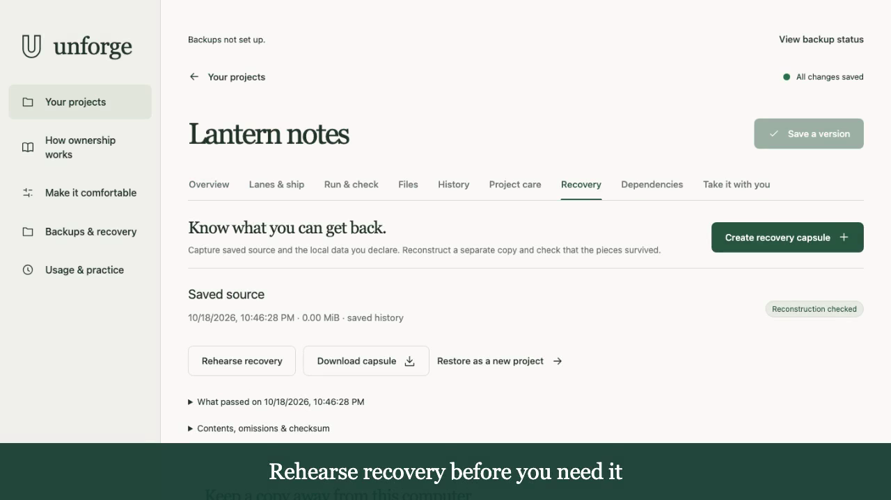

# Unforge

**Own the software AI helps you build.**

Unforge is a free, open-source home for software on your Mac. Your projects stay in ordinary Git repositories. Unforge keeps versions, isolated change proposals, local checks, releases, and recovery together without requiring an Unforge account, hosted database, or proprietary project format.

[Download Unforge for Mac](https://unforge.app) · [Watch the real workflow](https://unforge.app/#walkthrough) · [Install and recover](https://unforge.app/guide.html) · [Read the source](#build-from-source)

[](https://unforge.app/#walkthrough)

## One place to make a change and know you can get back

1. **Bring a project home.** Create one, copy a local folder without touching the original, or import a standard Git bundle.
2. **Describe the outcome.** Write a request for any coding agent, or use an installed Codex or Subscription Fleet account from Unforge.
3. **Review the actual change.** Agent proposals stay in separate Git worktrees. You see the changed files, diff, checks, and reviewer concerns before accepting anything.
4. **Keep a way back.** Save named versions, export the complete Git history, and create encrypted workspace recovery points on storage you already control.

Unforge is not another AI subscription. It does not sell model credits or put a cloud account between you and your files. AI is optional; when you use it, the installed provider and its own account terms still apply.

## What works today

- Native Apple-silicon Mac app, Developer ID signed and notarized; macOS 13+ and Git 2.30+.
- Local projects with ordinary Git history, paginated files, draft recovery, named versions, non-destructive restore, and portable Git-bundle export.
- Isolated work lanes with exact checked commits, overlap handling, merge review, retained release artifacts, and rollback.
- Trusted local static, Node, Python, and Swift runs with bounded output and process cleanup.
- Optional outcome-first AI proposals through an installed Codex CLI or Subscription Fleet. Unforge plans from the exact saved source before launching a provider and applies nothing without review.
- Encrypted incremental whole-workspace recovery points for iCloud Drive, a Google Drive desktop folder, or another disk. Restores create a separate workspace instead of overwriting the original.
- Project briefs, behavior examples, service and cost records, dependency clues, and recovery coverage that travel with the source.
- No Unforge login, telemetry service, central workspace server, or required GitHub remote.

## Start in five minutes

Download the current Mac build from [unforge.app](https://unforge.app), move `Unforge.app` to Applications, and open it. The app bundles its own runtime and backup tool; Node and Python are not required. Git remains a prerequisite.

Create a small project, change a file, and choose **Save a version**. Then open **Recovery**, create a source capsule, and rehearse it. The rehearsal reconstructs and verifies the saved source without executing the app.

For an existing app, choose **Bring an existing app**. Unforge reviews the folder before making an independent managed copy. Later changes in the original and the copy do not synchronize automatically.

The complete walkthrough covers [installation, first project, backups, and recovery](https://unforge.app/guide.html).

## Optional AI proposals

Unforge can use an existing installed and signed-in Codex CLI or Subscription Fleet. Start from a saved project and describe the result you want. Unforge prepares a read-only plan that names the likely files and a focused check before provider work begins. The provider works in a separate checkout; Unforge reconstructs and reviews the returned candidate before you may accept it.

The adapter cannot publish, deploy, contact people, provision services, enable paid fallback, or keep a daemon. Provider credentials, allowance snapshots, raw logs, and private routing state remain outside the project and public source. A successful provider exit is not treated as proof that a change works.

See the [agent API](docs/AGENT-API.md) for the exact local interface and boundaries.

## Recovery is broader than source control

Named versions and Git bundles preserve committed source history. Workspace recovery additionally includes managed projects, drafts, proposals, operation records, and explicitly declared local data.

Keep the complete `.ufvault` directory and the passphrase somewhere reachable without the original Mac. A `.ufpoint` identifies one recovery point inside its vault; it is not a standalone backup. Hosted databases, external uploads, credentials, Git LFS objects, and provider accounts need their own recovery arrangements.

## Honest boundaries

Unforge is a working alpha. It does not yet replace team editing, every repository type, provider billing dashboards, hosted-database backups, or a hostile-code sandbox. Project commands run with your Mac account's permissions. Only run code you trust.

Checks establish only what they actually exercise. A saved release is not automatically deployed, a deployment readback is not a user-flow test, and a successful local restore does not prove access to every external account on a replacement computer.

See the [product direction](docs/PRODUCT.md), [roadmap](docs/ROADMAP.md), [ownership and recovery model](docs/OWNERSHIP.md), and [security boundary](SECURITY.md).

## Build from source

The built source release runs on macOS or Linux with Python 3.10+ and Git 2.30+. Building the interface additionally needs Node.js 22.12+ with npm.

```sh
npm ci --ignore-scripts
npm run check
./start.sh
```

Open `http://127.0.0.1:4319`. The engine binds to loopback and the project format remains ordinary Git. Contributors should read [CONTRIBUTING.md](CONTRIBUTING.md); release construction and verification are documented in [docs/RELEASE.md](docs/RELEASE.md).

Unforge is available under the [MIT license](LICENSE).
